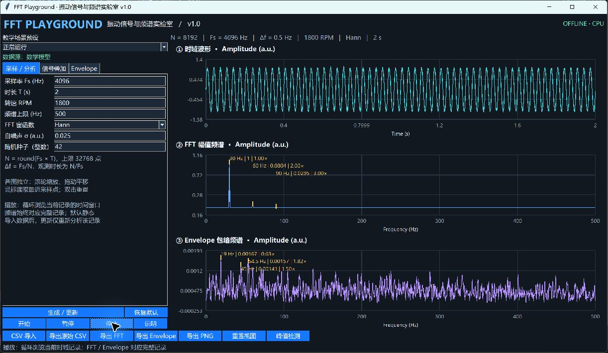
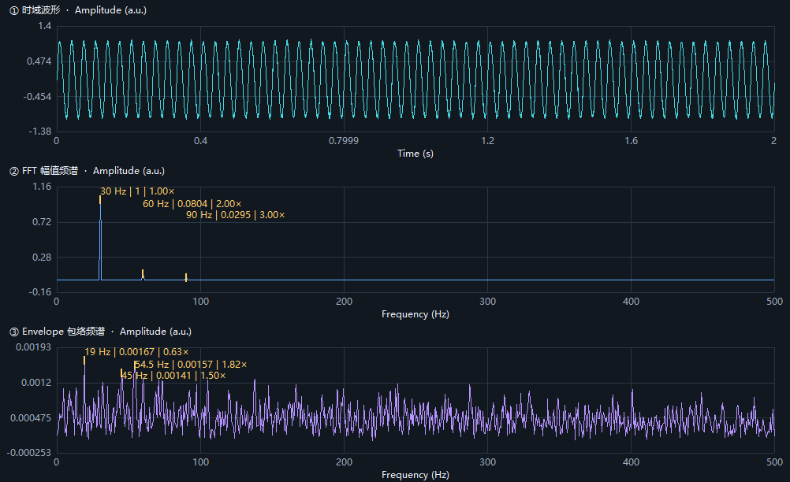

# FFT Playground v1.0 · 振动信号与频谱实验室

Windows 10/11 本地独立窗口，中文深色仪器界面。完全离线、CPU 运行，无账户、API Key、遥测或上传。自有源码采用 **Apache-2.0**。

**v1.0.2：**新增可调“正常运行（有底噪）”预设。[下载最新 Windows x64 便携版](https://github.com/Immortal-Kevin/CoderPlay/releases/tag/fft-playground-v1.0.2)。

**v1.0.1 启动修复：**解释器/Tk 自动预检、失败日志和保留控制台；修复250% DPI下固定尺寸与字体不同步造成的严重挤压。提供无需安装Python的[Windows x64便携版](https://github.com/Immortal-Kevin/CoderPlay/releases/tag/fft-playground-v1.0.1)：完整解压ZIP后双击 `FFT Playground.exe`，保留旁边的 `runtime/`、`application/` 和许可证文件。它是带运行时的文件夹版，不是可单独搬走的单文件EXE。详见 [PORTABLE_README.txt](PORTABLE_README.txt)、[实际打包许可证审计](PORTABLE_LICENSES.md) 和 [启动修复验收](STARTUP_FIX_RESULTS.md)。





上图是实际 Tk 窗口在 1366×768 下导出的原创三图视图；不是第三方参考图。左侧参数面板包含采样/分析、信号叠加和 Envelope 三个页签。

## Windows 安装与启动

安装带 Tkinter 的 Python 3.11+（官方 Windows 安装器通常已包含）。本版**没有运行时 pip 依赖**。双击 `run.bat`，或在本目录执行：

```powershell
py -3 app.py
```

`run.bat` 会依次预检项目 `.venv`、`py -0p` 列出的解释器、PATH和PEP514注册表安装，选择Python3.11+且真正创建Tk成功的解释器。WindowsApps的python商店跳转别名不会作为候选。预检有15秒超时，候选失败可继续尝试，错误显示解释器路径及真实异常；失败后控制台等待按键。仅对子进程忽略继承的PYTHONHOME/PYTHONPATH/TCL_LIBRARY/TK_LIBRARY，不修改系统设置，也不自动联网安装Python。

无法复现启动故障时直接运行 `run.bat --diagnose`，它会检查全部候选并等待Enter。日志在 `%LOCALAPPDATA%\FFT Playground\logs\launcher.log` 和 `application.log`（应用日志滚动保留）。需要指定解释器可执行 `powershell -NoProfile -ExecutionPolicy Bypass -File .\launch.ps1 -Diagnostic -PythonPath "C:\路径\python.exe"`。ExecutionPolicy只作用于该次PowerShell进程；不改变用户或系统执行策略。

验证 Tkinter 可用：`py -3 -m tkinter`。实际验收环境为 Windows、Python 3.14.7、Tcl/Tk 8.6.13；其他 Python 版本和 Windows 10 尚未逐一实测。网络仅用于开发时安装 pytest；已安装 Python 的用户运行应用无需联网。

## 功能与使用

- 叠加正弦（Hz/幅值/相位°）、自定义转频谐波、周期衰减冲击、固定种子高斯白噪声、AM 调幅。幅值0关闭分量，谐波留空关闭；格式如 `1:1,2:0.3,3:0.1,4.5:0.05`。
- 七个教学预设：正常、正常运行（有底噪）、不平衡、不对中、机械松动、轴承周期冲击、调幅边带。选择预设会恢复该预设全部参数，并返回数学模型数据源。
- **正常运行（有底噪）：**保持正常转频/谐波，叠加默认σ=0.15 a.u.的高斯白噪声，观察宽带谱底如何影响弱峰识别。在“采样 / 分析”页调整“背景底噪 σ (a.u.)”，按“生成 / 更新”生效；0关闭底噪，数值越大噪声越强。固定随机种子便于对比。原“正常运行”保留原有轻微噪声σ=0.025。这里调的是时域噪声标准差，不是直接设置频谱的dB底线；真实环境还可能出现有色、非平稳噪声，本预设仅模拟宽带随机背景。
- 可调 Fs、T、RPM、窗函数、频谱显示上限、包络带通频带和包络 DC 去除。修改后按“生成 / 更新”。
- 三图独立滚轮缩放、鼠标左键拖动平移、悬停读取最近记录点；双击重置。峰值检测显示当前频率视图内最多5峰，图上标注3峰（Hz、a.u.、转频倍数）。不插值，不把峰值精度写成优于 Δf。
- 默认静态。“开始”循环浏览已生成记录的20%时间窗，“暂停”保持时间窗，“停止”恢复全时域。频谱一直对应整段记录；此功能不模拟实时采集。
- CSV 自动识别 `time_s,amplitude`、`时间,幅值`，支持时间与幅值列换位，逗号/分号/Tab 分隔；无表头时取前两列。UTF-8/UTF-8 BOM，时间单位秒，幅值 a.u.。拒绝空文件、NaN/Inf、非递增时间、不均匀采样（容差0.1%）、超过8 MiB或32768点的记录。不会自动插值。
- 导入后保留原始时间（可非零起点）与幅值，按检测的 Fs 分析，初始包络频带重设为 `[0.15Fs,0.4Fs]`。请按实际载波调整。导入状态禁止改写 Fs/样本数；选择预设或恢复默认可返回生成模式。
- 分别导出原始 CSV、FFT CSV、Envelope CSV；文件首行 `#` JSON 包含最后成功计算的参数、来源、N、Δf和滤波说明。PNG 导出当前三图视图。**导出采用独占创建，已有文件名会报错，保护原始记录。**

## 数学实现与边界

为满足严格的分发许可证约束，v1.0 使用原创 Python 标准库 FFT 和 Tk Canvas/GDI，替代 NumPy/SciPy/Matplotlib 及其 Windows 二进制依赖。这是技术栈调整，不是把原始 FFT 当作包络。

`core/spectrum.py` 提供 `rfft`/`rfftfreq` 语义接口：前向 DFT 不归一化，逆变换除以N；2的幂使用 radix-2，其余使用 Bluestein 卷积。内部卷积填零不改变N点DFT的频率网格。没有借用第三方实现代码。

采样 `t[i]=i/Fs`、`N=round(Fs×T)`，实际观测时长 N/Fs，最后采样时刻 `(N-1)/Fs`；`Δf=Fs/N`。周期 Hann 为 `0.5−0.5cos(2πi/N)`。单边幅值先除以 `sum(window)`，再将内部正频率乘2；DC、偶数N的Nyquist不乘2，奇数N最后一点仍乘2。频点对齐的内部正弦恢复峰值幅度；非对齐信号仍存在泄漏、栅栏和扇贝损失。

冲击为每隔 `1/f_impact` 激励一次的 `A exp(−decay τ)sin(2πf_res τ)` 叠加；噪声强度是标准差σ。冲击振铃不是严格带限信号，接近Nyquist的共振及很大的衰减可能造成混叠；此模拟不能替代抗混叠采集。AM 为 `A(1+d cos(2πfm t))sin(2πfc t)`，理论边带位于 `fc±fm`，幅值 `Ad/2`。

Envelope：对完整记录作 FFT → 在所选带通外置零、带内两端各10%余弦过渡（中央80%增益为1）→ 正频率乘2、负频率置零 → 逆变换得到 Hilbert 解析信号 → 取模 → 可选减算术均值 → 窗函数与单边幅值 FFT。此滤波是零相位的循环频域滤波，记录边缘可能振铃；频带应覆盖载波及相关边带。去 DC 指去包络均值，非平稳记录经加窗后0频点不保证严格为零。不对 Envelope 幅值应用未经说明的诊断校准。

**所有故障预设仅为教学模型。** 1×/2×/多次谐波、边带和周期冲击不唯一对应某种机械故障。没有真实轴承几何参数、趋势、工况、传感器标定和现场证据，不能作确定诊断。本版轴承示例的12 Hz是用户设定的重复频率，不是假定某种轴承的BPFO/BPFI数据库值。

最多32768点、32个谐波；后台守护线程计算，主线程只轮询结果和绘制按像素保留极值的曲线。只有一个计算任务，关闭后不创建/遗留子进程。导入失败保留之前结果。图表仍可随窗口缩放；最低推荐1366×768。

## 架构、测试与许可证

`core/` 完全不依赖GUI；`ui/` 只通过 `Parameters → analyze → Analysis` 调用引擎；`io_utils/` 负责本地文件。未来游戏模块可使用独立包、入口、资产和许可证，参见 [core/EXTENSIONS.md](core/EXTENSIONS.md)。本版不含游戏或插件加载功能。

已按 Apache-2.0 发布的代码授权不可追溯撤销。未来新增自有模块可以专有授权；商业分发仍须保留核心Apache许可证及通知，并遵守所选实际分发组件的条件。商业许可采购预算为0；当前没有付费许可证或强制公开新增模块源码的依赖。

```powershell
py -3 -m venv .venv
.\.venv\Scripts\python -m pip install -r requirements-dev.txt
.\.venv\Scripts\python -m pytest -q
.\.venv\Scripts\python tools/license_audit.py --development
.\.venv\Scripts\python tools/gui_smoke.py test_output/gui.png
```

测试安装步骤需要网络；应用启动不需要这些包。v1.0初始结果见 [TEST_RESULTS.md](TEST_RESULTS.md)，v1.0.1结果见 [STARTUP_FIX_RESULTS.md](STARTUP_FIX_RESULTS.md)。[THIRD_PARTY_LICENSES.md](THIRD_PARTY_LICENSES.md)覆盖源码；[PORTABLE_LICENSES.md](PORTABLE_LICENSES.md)单独覆盖便携ZIP实际运行时及DLL。EXE通过自有C#启动器和标准库构建，不使用PyInstaller/cx_Freeze，也没有复制现有环境的site-packages或字体。

重建便携版（必须使用审计过的官方Python3.14.7 Windows x64运行时；Windows自带.NET Framework C#编译器）：

```powershell
python tools/build_portable.py --python-root "C:\路径\pythoncore-3.14-64" --output releases/FFT-Playground-v1.0.1-win64
python tools/audit_portable.py releases/FFT-Playground-v1.0.1-win64.zip
```

输出目录必须尚不存在，脚本不会删除已有产物。实际包有独立MANIFEST.json，记录文件、嵌套stdlib源码成员、SHA256及PE导入；运行时由`python314._pth`隔离。修改组件后必须重新核验，不能直接沿用旧审计。

## 只读参考与数学来源

本地 MobiusEX 仅识别文件、检查表格结构及相关技术主题，未复制任何PDF页面、图像、表格、数据或专有结论。详见 [REFERENCE_NOTES.md](REFERENCE_NOTES.md)。所有波形和图表由原创数学模型生成。

公开的数学定义参考（查阅定义，未复制代码、例图或文档段落）：

- [NumPy DFT/归一化说明](https://numpy.org/doc/stable/reference/routines.fft.html)
- [NumPy rfftfreq 频点定义](https://numpy.org/doc/stable/reference/generated/numpy.fft.rfftfreq.html)
- [SciPy Hilbert 解析信号定义](https://docs.scipy.org/doc/scipy/reference/generated/scipy.signal.hilbert.html)

许可证原文来源：[Apache-2.0](https://www.apache.org/licenses/LICENSE-2.0.txt)、[Python](https://docs.python.org/3.14/license.html)、[Tcl/Tk](https://www.tcl-lang.org/software/tcltk/license.html)、[pytest](https://docs.pytest.org/en/stable/license.html)。
